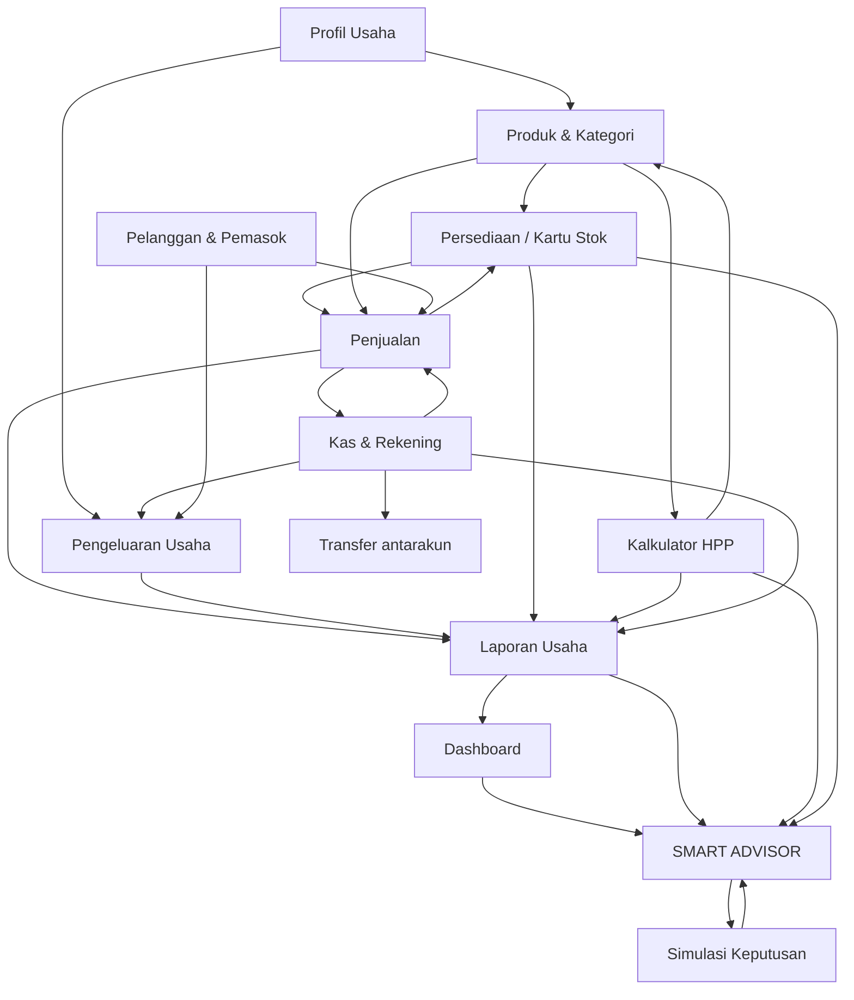
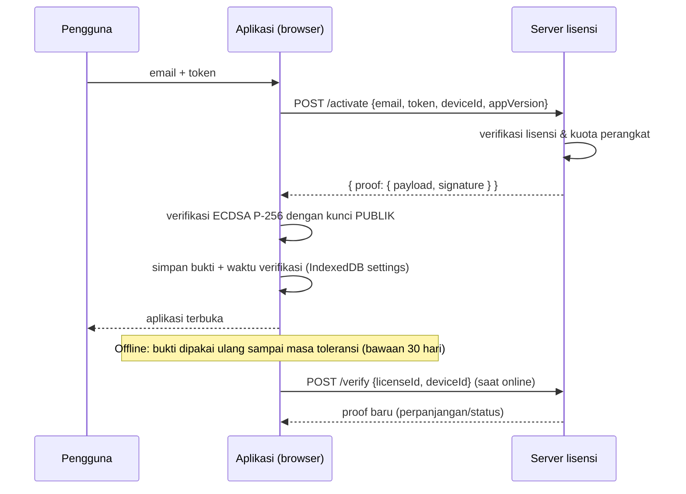
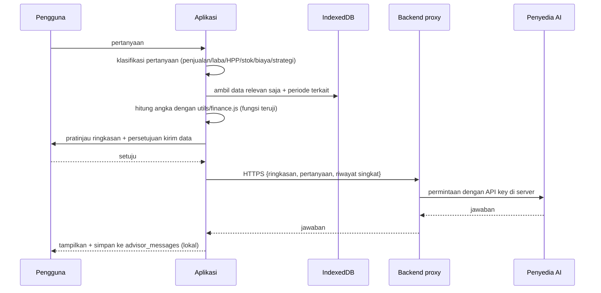

# UMKM SMART - Rancangan Arsitektur

Dokumen ini adalah rancangan yang diminta pada bagian N master prompt: ringkasan arsitektur,
diagram alur modul, struktur folder, rancangan database, navigasi, hubungan dengan layanan
lisensi dan AI, kebutuhan teknis, serta rencana implementasi bertahap.

Status saat ini: **Tahap 1 sampai Tahap 6 sudah diimplementasikan**, termasuk backup/restore tervalidasi, pemeriksaan konsistensi data, kas, laporan, dan SMART ADVISOR dengan persetujuan sebelum data dikirim. Modul yang belum aktif: PWA dan finalisasi lisensi menyusul pada Tahap 7-8. Menu yang belum aktif ditandai jelas di aplikasi.

---

## 1. Ringkasan arsitektur

UMKM SMART adalah **aplikasi web lokal (local-first)** berbasis React + Vite yang dipasang
sebagai PWA. Seluruh data usaha disimpan di perangkat pengguna melalui IndexedDB (Dexie.js).
Tidak ada database cloud untuk data transaksi.

```
+--------------------------- Perangkat pengguna ----------------------------+
|  React + Vite (PWA)                                                       |
|   - Halaman & komponen UI (React Router, Lucide, Recharts)                 |
|   - Logika bisnis: utils/finance.js, utils/money.js (fungsi murni, teruji) |
|   - Validasi formulir: Zod                                                |
|   - Lapisan data: database/db.js + repositories/*                          |
|          |                                                                |
|          v                                                                |
|   IndexedDB "umkm-smart" (Dexie, berversi & bermigrasi)                    |
+------------------------------|--------------------------------------------+
                               | HTTPS (hanya bila diperlukan)
              +----------------+----------------+
              |                                 |
              v                                 v
   Layanan lisensi (server)          Backend proxy AI (server)
   - verifikasi email + token        - menyimpan API key penyedia AI
   - tanda tangan bukti aktivasi     - meneruskan ringkasan data (bukan DB)
   - riwayat aktivasi perangkat      - tidak menyimpan data transaksi
```

Prinsip:

1. **Offline-first.** Pencatatan usaha berjalan tanpa internet. Hanya aktivasi lisensi dan
   SMART ADVISOR yang membutuhkan koneksi.
2. **Uang sebagai integer rupiah.** Tidak ada nilai uang desimal, sehingga tidak ada galat
   pembulatan floating point.
3. **Perhitungan di aplikasi, bukan di AI.** AI hanya menerima ringkasan hasil perhitungan.
4. **Satu unit usaha per instalasi** (Single Business Edition).
5. **Tidak ada rahasia di frontend.** Hanya kunci publik lisensi yang boleh ada di klien.

---

## 2. Diagram alur hubungan modul



Alur uang yang harus konsisten:

```
Penjualan  -> stok berkurang (stock_movements) + kas masuk (cash_transactions)
Pembatalan -> transaksi pembalik: stok kembali + kas keluar, bukan menghapus riwayat
Pengeluaran-> kas keluar (cash_transactions), TIDAK menambah HPP bila sudah masuk komponen HPP
Transfer   -> keluar dari akun asal + masuk ke akun tujuan (bukan pendapatan/pengeluaran)
```

Pemisahan yang wajib dijaga di laporan:

| Istilah | Arti |
|---|---|
| Omzet | Nilai penjualan, belum dikurangi apa pun |
| HPP | Biaya langsung barang/jasa yang terjual |
| Laba kotor | Omzet - HPP |
| Biaya operasional | Pengeluaran periode, tanpa komponen yang sudah masuk HPP |
| Estimasi laba bersih | Laba kotor - biaya operasional |
| Arus kas | Perpindahan uang masuk/keluar |
| Saldo kas | Uang yang ada di akun kas saat ini (bukan laba) |

---

## 3. Struktur folder proyek

```
umkm-smart/
├── docs/                          # dokumen rancangan & catatan tahap
├── public/                        # aset statis (ikon)
├── index.html
├── vite.config.js
├── .env.example                   # konfigurasi publik lisensi
└── src/
    ├── main.jsx                   # bootstrap React, router, toast
    ├── App.jsx                    # rute + gerbang lisensi
    ├── assets/
    ├── components/
    │   └── ui/                    # Button, Card, Field, Badge, Modal, Toast, EmptyState
    ├── layouts/
    │   ├── AppLayout.jsx           # sidebar + topbar + outlet
    │   ├── Sidebar.jsx
    │   └── navigation.js          # konfigurasi menu & penanda tahap
    ├── pages/
    │   ├── dashboard/             # DashboardPage, PeriodFilter  (Tahap 1)
    │   ├── profile/               # ProfilePage                   (Tahap 1)
    │   ├── settings/              # SettingsPage                  (Tahap 1)
    │   ├── activation/            # ActivationPage                (Tahap 1)
    │   ├── products/              # (Tahap 2)
    │   ├── hpp/                   # (Tahap 3)
    │   ├── inventory/             # (Tahap 2)
    │   ├── sales/                 # (Tahap 4)
    │   ├── expenses/              # (Tahap 4)
    │   ├── cash/                  # (Tahap 5)
    │   ├── contacts/              # (Tahap 4) ContactsPage + ContactFormDialog
    │   │                          #           untuk pelanggan dan pemasok
    │   ├── reports/               # (Tahap 5)
    │   ├── backup/                # Backup & Data (Tahap 5, bagian Tahap 7 dipercepat)
    │   ├── advisor/               # (Tahap 6) AdvisorPage, AdvisorChat,
    │   │                          #           AdvisorConsentDialog, DecisionSimulator
    │   └── ComingSoonPage.jsx
    ├── database/
    │   ├── db.js                  # instance Dexie + versi + populate
    │   ├── schema.js              # 20 tabel, indeks, konstanta
    │   ├── seed.js                # data referensi (satuan, kategori, akun kas)
    │   └── repositories/          # akses data per entitas + audit log
    ├── services/
    │   ├── license/               # constants, device, storage, service, context
    │   ├── backup/                # backupService (ekspor/impor/checksum), consistency
    │   └── ai/                    # (Tahap 6) advisorContext, aiProvider, prompt,
    │                              #           localAdvisor, advisorRepo
    ├── hooks/                     # useDashboardData, (tahap berikutnya)
    ├── utils/                     # money, dates, finance, validation
    └── styles/                    # theme.css (token), global.css (komponen)
```

---

## 4. Rancangan database Dexie.js

Nama database: `umkm-smart`, versi skema saat ini **3**. Primary key memakai UUID string
agar konsisten dan aman saat backup/restore. Tanggal usaha disimpan sebagai `YYYY-MM-DD`,
waktu pencatatan sebagai ISO string. Kolom boolean tidak diindeks (batasan IndexedDB).

| # | Tabel | Isi | Indeks |
|---|---|---|---|
| 1 | `business_profile` | Satu baris profil usaha (id `primary`) | id, businessName, updatedAt |
| 2 | `users` | Pemilik/operator lokal aplikasi | id, email, name, role, createdAt |
| 3 | `categories` | Kategori produk/bahan | id, name, type, createdAt |
| 4 | `units` | Satuan (pcs, kg, liter, ...) | id, name, createdAt |
| 5 | `products` | Produk barang/jasa, harga, stok, minimum | id, sku, name, categoryId, type, unitId, createdAt |
| 6 | `product_costs` | Versi perhitungan HPP per produk | id, productId, businessType, effectiveDate, createdAt |
| 7 | `cost_components` | Komponen biaya milik satu perhitungan HPP | id, productCostId, productId, costType, createdAt |
| 8 | `stock_movements` | Kartu stok: awal/masuk/keluar/penyesuaian/penjualan/pembatalan | id, productId, type, date, createdAt |
| 9 | `sales` | Header penjualan (invoice, total, metode bayar, status) | id, invoiceNumber, date, status, paymentMethod, cashAccountId, createdAt |
| 10 | `sale_items` | Detail item; harga & HPP dibekukan saat transaksi | id, saleId, productId, createdAt |
| 11 | `expenses` | Pengeluaran operasional | id, date, expenseCategoryId, cashAccountId, createdAt |
| 12 | `expense_categories` | Kategori pengeluaran (bisa ditambah pengguna) | id, name, createdAt |
| 13 | `cash_accounts` | Akun tunai/bank/e-wallet + saldo awal | id, name, type, createdAt |
| 14 | `cash_transactions` | Mutasi kas, termasuk transfer & pembalik | id, cashAccountId, type, date, refType, refId, createdAt |
| 15 | `customers` | Kontak pelanggan | id, name, phone, createdAt |
| 16 | `suppliers` | Kontak pemasok | id, name, phone, createdAt |
| 17 | `settings` | Preferensi, lisensi, ID instalasi | key |
| 18 | `audit_logs` | Catatan perubahan penting | id, action, entity, entityId, createdAt |
| 19 | `advisor_conversations` | Percakapan SMART ADVISOR | id, title, createdAt, updatedAt |
| 20 | `advisor_messages` | Pesan dalam percakapan | id, conversationId, role, createdAt |
| 21 | `product_price_history` | Riwayat harga beli, harga jual, dan HPP tiap produk (tabel tambahan, ditambahkan pada skema v2) | id, productId, changedAt |
| 22 | `backups` | Cadangan lokal cepat (payload JSON + metadata), maksimal 2 terbaru. **Bukan data usaha**; tidak ikut diekspor | id, createdAt |

Catatan tabel ke-22: tabel `backups` ditambahkan pada skema v3 untuk pemulihan tanpa berkas dan
jaring pengaman otomatis sebelum pemulihan dari berkas. Isinya tidak dihitung sebagai data usaha
dan tidak disertakan dalam berkas cadangan.

Catatan tabel ke-21: master prompt mewajibkan setiap produk memiliki riwayat perubahan harga
dan HPP, sedangkan `product_costs` khusus menyimpan hasil kalkulator HPP. Karena itu riwayat
harga manual disimpan pada tabel tersendiri agar dapat ditampilkan dan diaudit, bukan
ditumpuk di `audit_logs`.

Tahap 3 memakai tabel `product_costs` dan `cost_components` yang sudah ada sejak skema v1,
sehingga tidak memerlukan versi skema baru; data Tahap 2 tetap utuh.

Relasi utama:

```
business_profile (1)          categories (1) --< products
units (1) --< products        products (1) --< product_costs --< cost_components
products (1) --< stock_movements
sales (1) --< sale_items >-- products          (sale_items.costPrice = HPP saat jual)
sales (1) --< cash_transactions (refType='sale')
expenses (1) --< cash_transactions (refType='expense')
cash_accounts (1) --< cash_transactions
customers (1) --< sales (customerId)              suppliers (1) --< stock_movements (supplierId)
advisor_conversations (1) --< advisor_messages
```

Contoh bentuk record (kolom penting):

```js
// products
{ id, sku, name, categoryId, unitId, type: 'barang' | 'jasa',
  purchasePrice, sellingPrice, hpp, stockQty, minStock, trackStock,
  isActive, imageDataUrl, createdAt, updatedAt }

// sales
{ id, invoiceNumber, date: '2026-11-17', customerId, subtotal, discount, total,
  totalCost, paymentMethod: 'tunai'|'transfer'|'qris'|'ewallet'|'lainnya',
  cashAccountId, status: 'selesai'|'dibatalkan', note, createdAt, updatedAt }

// sale_items
{ id, saleId, productId, name, qty, price, discount, subtotal, costPrice, createdAt }

// cash_transactions
{ id, cashAccountId, type: 'masuk'|'keluar', amount, date, refType:
  'sale'|'sale_cancel'|'expense'|'transfer'|'manual'|'opening', refId,
  description, createdAt }
```

### Migrasi skema

- `db.version(1).stores(STORES_V1)` tidak boleh diubah setelah dipakai.
- Versi 2 sudah ditambahkan: `db.version(2).stores(STORES_V2)` (menambah
  `product_price_history`). Versi 3 menambah `backups` tanpa mengubah data usaha.
  Perubahan berikutnya memakai pola yang sama.
- `db.on('populate')` hanya untuk database baru; data referensi baru pada versi lanjutan
  harus ditambahkan lewat `upgrade()`, bukan dengan menghapus database.
- Impor/restore (sudah tersedia): berkas divalidasi (format, versi, kelengkapan tabel, jumlah
  baris, checksum SHA-256), data saat ini dicadangkan otomatis, lalu seluruh tabel ditimpa dalam
  satu transaksi. Pengaturan lisensi perangkat dipertahankan.

---

## 5. Rancangan navigasi dan halaman

Menu utama (sidebar pada layar besar, drawer pada layar kecil):

| Grup | Menu | Rute | Status |
|---|---|---|---|
| Utama | Dashboard | `/` | Tahap 1 - aktif |
| Utama | Profil Usaha | `/profil` | Tahap 1 - aktif |
| Operasional | Produk | `/produk` | Tahap 2 - aktif |
| Operasional | Persediaan | `/persediaan` | Tahap 2 - aktif |
| Operasional | Kalkulator HPP | `/hpp` | Tahap 3 - aktif |
| Operasional | Penjualan | `/penjualan` | Tahap 4 - aktif |
| Operasional | Pengeluaran | `/pengeluaran` | Tahap 4 - aktif |
| Operasional | Kas & Rekening | `/kas` | Tahap 5 - aktif |
| Relasi | Pelanggan | `/pelanggan` | Tahap 4 - aktif |
| Relasi | Pemasok | `/pemasok` | Tahap 4 - aktif |
| Analisis | Laporan Usaha | `/laporan` | Tahap 5 - aktif |
| Analisis | SMART ADVISOR | `/advisor` | Tahap 6 - aktif |
| Sistem | Pengaturan | `/pengaturan` | Tahap 1 - aktif |
| Sistem | Backup & Data | `/backup` | Tahap 5 - aktif |
| - | Aktivasi lisensi | `/aktivasi` | Tahap 1 - aktif |

Halaman tambahan yang direncanakan:

- `/penjualan/baru` sudah ada; `/penjualan/:id` dan cetak bukti belum
- `/pengeluaran/baru` dan `/kas/transfer` berupa tab/dialog di halaman terkait
- `/laporan/:jenis` masih berupa pemilih laporan di satu halaman
- Simulasi keputusan berupa tab di `/advisor`, bukan rute terpisah

Dashboard (Tahap 1) menampilkan: penjualan hari ini, penjualan bulan ini, omzet/HPP/laba
kotor/laba bersih sesuai periode, pengeluaran, saldo kas, produk aktif, stok menipis,
grafik penjualan, grafik pengeluaran, dan transaksi terbaru, dengan filter periode
(hari ini, minggu ini, bulan ini, tahun ini, rentang khusus).

---

## 6. Hubungan aplikasi dengan layanan lisensi



Ketentuan yang sudah diterapkan pada Tahap 1:

- Verifikasi dilakukan di server; aplikasi memverifikasi bukti dengan **kunci publik**
  ECDSA P-256 (`VITE_LICENSE_PUBLIC_KEY_JWK`). Private key tidak pernah ada di klien.
- `payload` adalah string JSON persis yang ditandatangani server; `signature` base64url.
- Email pada bukti harus sama dengan email yang diaktifkan; `deviceId` harus cocok.
- Status lisensi: `active`, `offline_grace`, `offline_grace_expired`, `expired`,
  `revoked`, `invalid`, `unactivated`.
- Masa toleransi offline default 30 hari, disimpan di `settings.license.offlineGraceDays`
  dan dapat ditimpa server melalui `payload.offlineGraceDays`.
- Mode pengembangan tersedia untuk pengujian, selalu menampilkan banner dan tercatat di
  audit log. Ini bukan aktivasi sah.
- Keterbatasan yang diakui: penanda perangkat adalah ID instalasi di IndexedDB, bukan
  pengenal perangkat keras. Aplikasi lokal tidak mungkin mustahil disalin; perlindungan
  lisensi bersifat wajar (verifikasi server + bukti bertanda tangan + masa toleransi).

Kontrak server yang perlu disiapkan penerbit (Tahap 8):

```
POST /activate  -> 200 { proof: { payload, signature } } | 4xx { message }
POST /verify    -> 200 { proof: { payload, signature } } | 4xx { message }
payload = {
  licenseId, email, deviceId, status: 'active'|'revoked'|'inactive',
  issuedAt, expiresAt|null, offlineGraceDays|null, plan
}
Tanda tangan: ECDSA P-256 + SHA-256 atas byte UTF-8 dari string payload.
```

---

## 7. Hubungan SMART ADVISOR dengan layanan AI

Alur wajib (Tahap 6), tanpa mengirim seluruh database:



Aturan:

- Tidak mengirim password, token lisensi, API key, data pelanggan yang tidak perlu, atau
  seluruh isi database.
- Angka dihitung aplikasi; AI menjelaskan dan memberi rekomendasi.
- Adapter penyedia: `services/ai/aiProvider.js` (OpenAI, Gemini, dan penyedia kompatibel). Semua
  permintaan menuju satu proxy; `aiProvider.js` mengirim `{provider, model, messages}` ke
  `POST {proxyUrl}/advisor` dan menerima `{answer, model?, usage?}`.
- API key disimpan di backend proxy (bukan frontend). BYOK tetap melalui proxy. Alamat proxy diambil
  dari `VITE_AI_PROXY_URL` atau diisi di panel Koneksi AI (tersimpan di `settings`).
- Persetujuan: sebelum setiap kiriman, `AdvisorConsentDialog` menampilkan pertanyaan, daftar bagian
  ringkasan, data yang tidak disertakan, dan pratinjau teks lengkap; tombol kirim baru aktif setelah
  kotak persetujuan dicentang. Ringkasan berukuran sekitar 1.000 karakter.
- Tanpa proxy, advisor membuat **analisis lokal** deterministik yang diberi label jelas "Analisis
  lokal - tanpa AI"; tidak ada permintaan jaringan.
- Riwayat percakapan disimpan lokal di `advisor_conversations` dan `advisor_messages`; setiap kiriman
  menulis audit log tanpa isi pertanyaan/jawaban.
- Struktur jawaban: Kondisi usaha, Temuan, Analisis, Rekomendasi (maks. 3 prioritas),
  Langkah tindakan, Catatan. AI membedakan fakta, dugaan, rekomendasi; tidak mengarang
  angka dan tidak menjanjikan hasil.
- Simulasi keputusan dihitung aplikasi (`DecisionSimulator`), AI menjelaskan konsekuensinya.
- Fitur AI memerlukan internet; pencatatan tetap berjalan offline.

---

## 8. Daftar kebutuhan teknis

| Kebutuhan | Keterangan |
|---|---|
| Runtime pengembangan | Node.js 18+ dan npm |
| Frontend | React 18, Vite 5, React Router 6, JavaScript (bukan TypeScript) |
| Database lokal | Dexie 4 (IndexedDB), skema berversi |
| Ikon & grafik | lucide-react, recharts |
| Validasi | zod |
| Ekspor (Tahap 5) | `xlsx` untuk Excel, `jspdf` + `jspdf-autotable` untuk PDF (dimuat dinamis) |
| PWA (Tahap 7) | `vite-plugin-pwa`, service worker, manifest, prompt pembaruan |
| Backup (Tahap 5) | ekspor JSON berversi + checksum SHA-256, validasi, cadangan lokal, konfirmasi timpa data, pemeriksaan konsistensi |
| Lisensi | HTTPS endpoint `/activate` dan `/verify`, kunci ECDSA P-256 |
| AI (Tahap 6) | Backend proxy HTTPS + API key penyedia di server |
| Browser target | Chrome/Edge/Firefox/Safari modern, Android Chrome; butuh WebCrypto (ECDSA P-256) |
| Biaya | Aplikasi inti tanpa biaya berjalan (lokal). Lisensi/AI memerlukan server sendiri; biaya penyedia AI ditanggung penerbit (skema penerbit) atau pengguna (BYOK) |

Keterbatasan teknis yang harus diketahui pengguna:

- Data tidak tersinkron antarlaptop dan HP; pemindahan data lewat berkas backup (sudah tersedia).
- Berkas backup tidak dienkripsi; berisi data usaha dan harus disimpan di tempat aman.
- Menghapus data browser menghapus data usaha.
- Data lokal belum dienkripsi; jangan menyatakan sebaliknya.
- Aktivasi dan AI memerlukan internet; pencatatan tidak.

---

## 9. Rencana implementasi bertahap

| Tahap | Isi | Status |
|---|---|---|
| 1 | Fondasi: React+Vite, struktur folder, Dexie 20 tabel, router, layout, dashboard awal, profil usaha, fondasi lisensi | **Selesai** |
| 2 | Produk & persediaan: kategori, satuan, CRUD produk, riwayat harga, kartu stok, peringatan stok | **Selesai** |
| 3 | Kalkulator HPP: komponen biaya per jenis usaha, HPP per unit, riwayat, simulasi harga/margin | **Selesai** |
| 4 | Transaksi: penjualan + pembatalan aman, pengeluaran, integrasi stok dan kas, pelanggan/pemasok | **Selesai** |
| 5 | Keuangan & laporan: akun kas, transfer, dashboard lengkap, 9 laporan, ekspor Excel/PDF; backup/restore + pemeriksaan konsistensi | **Selesai** |
| 6 | SMART ADVISOR: chat, ringkasan kontekstual, adapter AI, proxy, simulasi, riwayat, privasi | **Selesai (proxy disiapkan penerbit)** |
| 7 | Backup & PWA: ekspor/impor tervalidasi, pemulihan, manifest, offline, pembaruan | Sebagian (backup/restore & pemeriksaan selesai; PWA dan backup terjadwal belum) |
| 8 | Lisensi & finalisasi: server aktivasi, pengelolaan perangkat, toleransi offline, pengujian menyeluruh, dokumentasi | Sebagian (sisi klien sudah ada) |

Ketergantungan: Tahap 3 membutuhkan produk (Tahap 2); Tahap 4 membutuhkan produk, stok,
dan akun kas; Tahap 5 membutuhkan transaksi; Tahap 6 membutuhkan laporan dan perhitungan
yang sudah teruji; Tahap 7 membutuhkan seluruh struktur data stabil.

Setiap tahap diuji sebelum tahap berikutnya dimulai, dan data lama tidak boleh dihapus
saat pembaruan versi.
